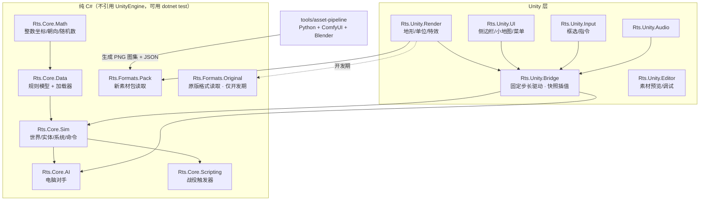

# M0 架构文档：红警2风格单机 RTS（Unity 重制）

> 状态：草案 v0.1 ｜ 项目代号待定（下文统一用 `Rts` 作为命名空间和程序集前缀，定名后全局替换）

---

## 0. 已确定的决策

| 编号 | 决策 | 说明 |
|---|---|---|
| D1 | 只做单机 | 遭遇战（对电脑）+ 战役；不做联机、不做锁步同步 |
| D2 | 引擎：Unity 2022 LTS（2022.3.x） | Unity 6 及之后的版本不向中国大陆和港澳用户提供，见 [ADR 0002](adr/0002-unity-2022-lts.md)。团队内统一锁定同一个小版本号；Unity Personal 对过去 12 个月收入/融资低于 20 万美元的个人免费 |
| D3 | 语言：C#，上限 C# 9 | Unity 2022.3 官方文档列出的编译器语言版本为 C# 9，API 兼容级别为 .NET Standard 2.1 |
| D4 | 代码许可证：MIT；美术/音频许可证：CC BY 4.0 | 仓库根目录放 `LICENSE`（MIT）和 `assets/LICENSE`（CC BY 4.0） |
| D5 | 参考资料：大模型只使用公开文档 | 不向大模型提供任何项目源码作为参考，见 §2.2 |
| D6 | 美术：风格相似、完全重新制作 | 原版素材只能在本机做对照，不能作为生成输入，也不能进入仓库，见 §2.3 |
| D7 | 低调发布 | 项目名、简介、标签中不出现 “Red Alert / 红色警戒 / Command & Conquer / Westwood / EA” |

---

## 1. 目标与非目标

**目标**
- 复刻红警2的核心玩法手感：等距 2.5D 视角、采矿经济、侧边栏建造、单位克制、超级武器。
- 引擎可以在开发期直接读取**本机合法拥有**的原版文件，用来对照画面和数据；发布版只包含原创素材。
- 模拟层与 Unity 解耦，可以在命令行下无画面运行、测试和回放。
- 绝大部分代码由大模型编写，由人负责架构和验收。

**非目标（至少 M5 之前不做）**
- 联机对战、天梯、反作弊。
- 与原版存档、录像或地图二进制格式完全兼容（地图只做导入工具）。
- 移动端和主机平台。
- 尤里的复仇阵营（M5 之后再评估）。

---

## 2. 约束

### 2.1 许可证
- 所有自研代码：MIT。每个源文件不需要单独写文件头，以根目录 `LICENSE` 为准。
- 美术、音频、地图：CC BY 4.0，署名写在 `assets/CREDITS.md` 里。
- 第三方依赖只能使用 MIT、BSD、Apache-2.0、zlib 这类宽松许可证，**禁止引入 GPL/LGPL/AGPL 代码**。每个依赖登记在 `THIRD_PARTY.md` 里（名称、版本、许可证、用途）。
- AI 模型：使用前核对它的许可证对**生成物**有没有限制（例如是否禁止商用、是否要求附加声明），只选生成物可以按 CC BY 发布的模型，并记录在 `tools/asset-pipeline/MODELS.md` 中。

### 2.2 参考资料白名单和黑名单

| 允许提供给大模型 | 禁止提供给大模型 |
|---|---|
| ModEnc wiki 上的格式和 INI 键说明（由人整理成 `docs/specs/` 下的规格文档后再提供） | OpenRA 及其各模组的源码仓库（它的 AGENTS.md 明确禁止 AI 分析和生成） |
| 公开的文件格式说明文章、论坛帖子 | EA 开源的 C&C / 红警1 / 将军源码（GPL） |
| 公开的设计文章、视频、通用 RTS 算法资料（A*、流场、群体移动等） | XCC Utilities 等工具的源码 |
| 本项目自己的规格文档和代码 | 原版游戏文件的二进制内容、原版截图（不用作图像生成输入） |

规则：人可以阅读任何公开资料，但交给大模型的只能是**我们自己写的规格说明**。

### 2.3 原版素材隔离
- 原版游戏路径通过环境变量 `RTS_ORIGINAL_DIR` 或本地配置文件 `user.local.json`（已加入 `.gitignore`）提供。
- 读取原版格式的代码只放在 `Rts.Formats.Original` 程序集里，**发布构建时不包含这个程序集**（通过 asmdef 的 Define Constraints 或构建脚本剔除）。
- `.gitignore` 和 CI 检查：仓库中禁止出现 `*.mix *.shp *.vxl *.hva *.tmp *.pal *.csf *.aud *.bag *.idx *.bik` 文件，以及原版 ini 的副本。
- 从原版导出的任何中间产物（PNG、JSON 等）只能放在 `Local/`（已忽略）目录。

---

## 3. 总体架构



**依赖规则（由 CI 检查）**
1. `Rts.Core.*` 和 `Rts.Formats.*` 的 asmdef 设置 `noEngineReferences: true`，禁止 `using UnityEngine`。
2. 模拟层不知道画面的存在：Sim 只输出状态和事件（例如“单位 42 开火”），由 Unity 层决定播放什么动画和音效。
3. Unity 层不能直接修改模拟状态，只能提交**命令**（`ICommand`）。
4. 不使用 Unity 物理、NavMesh 和 Animator 驱动游戏逻辑。

---

## 4. 仓库结构

```
/
├─ LICENSE                      # MIT
├─ README.md                    # 说明“需要自备原版游戏才能使用开发期对照功能”
├─ AGENTS.md                    # 给大模型的编码规范（§11 的内容）
├─ THIRD_PARTY.md
├─ docs/
│  ├─ architecture.md           # 本文档
│  ├─ adr/                      # 架构决策记录，一事一文件
│  └─ specs/                    # 由人整理的规格文档：格式、规则键、系统行为
├─ core/                        # 纯 C#，同时作为 Unity 本地包
│  ├─ package.json              # UPM 包描述
│  ├─ Rts.Core.Math/   (asmdef + .cs)
│  ├─ Rts.Core.Data/
│  ├─ Rts.Core.Sim/
│  ├─ Rts.Core.AI/
│  ├─ Rts.Core.Scripting/
│  ├─ Rts.Formats.Pack/
│  └─ Rts.Formats.Original/
├─ dotnet/                      # 让 core/ 能脱离 Unity 编译和测试
│  ├─ Rts.slnx
│  ├─ Directory.Build.props
│  ├─ Rts.Core.*/               # 每个 asmdef 对应一个 csproj（netstandard2.1 + C# 9），通配包含 ../../core/<同名目录>/**/*.cs；
│  │                            # 项目引用和 asmdef 的 references 保持一致，编译器就能拦住反向依赖
│  ├─ Rts.Tests/                # xUnit
│  └─ Rts.Cli/                  # 命令行：无画面跑对局、回放、导出图片
├─ unity/                       # Unity 工程（在本机用 Unity Hub 创建，见 unity/README.md）
│  ├─ Packages/manifest.json    # 以 "file:../../core" 引用 core 包
│  └─ Assets/Rts.Unity.*/
├─ content/                     # 自研规则数据（YAML），可提交
│  ├─ rules/  maps/  campaigns/
├─ assets/                      # 原创素材成品（CC BY）
│  ├─ LICENSE  CREDITS.md
│  └─ packs/<pack-name>/        # PNG 图集 + JSON 元数据 + 音频
├─ tools/
│  ├─ ci/check_repo.py          # 禁止文件检查和 core 依赖规则检查（CI 和 pre-commit 共用）
│  └─ asset-pipeline/           # 见 §9
└─ Local/                       # 已忽略：原版导出物、本机配置、缓存
```

---

## 5. 模拟层设计（Rts.Core.Sim）

### 5.1 时间
- 固定步长 tick，默认每秒 15 tick（作为配置项，以后可以调整）。“游戏速度”只改变每秒执行多少个 tick，不改变单个 tick 的逻辑。
- 规则数据中以“帧”为单位的数值，统一通过 `TickRate` 常量换算，**不要在各个系统里各自换算**。
- Unity 层用累加器驱动 tick；渲染在两个 tick 之间插值，保证画面流畅。

### 5.2 坐标和数值
- 地图格：`CellPos(int X, int Y)`；格内细分：每格 256 个单位（沿用原版的 lepton 概念），世界坐标为 `WorldPos(int X, int Y, int Z)`。
- 朝向：`Facing`，用整数表示（0–255 或 0–1023，在 `docs/specs/math.md` 中定死）。
- 位置和朝向等**状态一律使用整数**。中间计算可以用浮点数，但写回状态前必须取整。这样同一台机器上的录像回放结果稳定，规则里的距离、速度数值也能直接使用。
- 随机数：模拟层只能使用 `SimRandom`（种子固定，状态可以序列化），禁止使用 `System.Random` 和 `UnityEngine.Random`。

### 5.3 世界和实体
- `World`：唯一的状态容器，包含地图、玩家（House）、实体表、随机数和 tick 计数，可以整体序列化。
- 实体用**组合**的方式组装：`Entity` 只有 Id，加上若干组件（`Health`、`Mobile`、`Armament`、`Harvester`、`Building`、`Producer`、`Turret`……）。组件是纯数据，可以序列化。
- 系统按固定顺序每 tick 执行一次：

```
1. CommandSystem      处理本 tick 的玩家和 AI 命令
2. ProductionSystem   建造队列、电力、资金
3. AISystem           电脑对手决策（只产生命令，下一 tick 生效）
4. ScriptSystem       战役触发器
5. MovementSystem     寻路结果消费、移动、避让
6. TurretSystem / TargetingSystem
7. WeaponSystem       开火、弹道、爆炸、伤害
8. HarvestSystem
9. DeathSystem        死亡、残骸、经验
10. VisibilitySystem  战争迷雾
11. EventFlush        输出给表现层的事件列表
```

- 遍历顺序固定：实体按 Id 升序遍历；**禁止在模拟逻辑里遍历 `Dictionary` 或 `HashSet`**，需要时使用有序容器。

### 5.4 命令、存档和回放
- 所有输入都是命令：`Move`、`AttackMove`、`Attack`、`Guard`、`Deploy`、`Build`、`PlaceBuilding`、`Sell`、`Repair`、`SuperWeapon`……每条命令带 `Tick` 和 `PlayerId`。
- **存档** = `World` 序列化（MessagePack 或自定义二进制格式，带版本号）。
- **录像** = 初始参数（地图、规则版本、种子） + 命令日志。每 N 个 tick 记录一次 `World.StateHash()`。
- **回归测试**：`Rts.Cli replay <file>` 重放录像，比对状态哈希。大模型每次修改代码后都要跑一遍，哈希变化必须在提交说明中解释原因。

### 5.5 寻路和移动
- 第一版：格子 A* + 路径缓存，每种移动类型（步兵、履带、轮式、两栖、海军、飞行）各有一张通行代价表。
- 第二版（大批单位卡顿时）：分层寻路（区域图 + 局部 A*）或流场。
- 群体移动：编队偏移、局部避让、拥堵时等待或重新寻路。行为规格写在 `docs/specs/movement.md`。

### 5.6 战斗
- 数据链路：`Weapon` → `Projectile` → `Warhead`（按护甲类型给出伤害系数） → `Health`。
- 弹道类型：直射、抛物线、导弹、即时（激光/电弧）。

---

## 6. 数据层（Rts.Core.Data 与 content/）

- **自研规则格式**：YAML，一个单位一个节点，键名尽量沿用原版 ini 的语义（例如 `Strength`、`Speed`、`Cost`、`Primary`），方便对照。
- `content/rules/` 中的数值和名称**由我们自己填写和调平衡**，单位使用原创名称。
- **导入工具**（开发期，只在本机运行）：`Rts.Cli import-rules <rulesmd.ini>`，把原版 ini 转成同样的 YAML 并输出到 `Local/imported/`，用来对照手感，**不能提交**。
- 加载时做模式校验：未知键、类型错误、引用了不存在的武器等问题都直接报错，避免大模型写错数据后静默失败。

---

## 7. 资源层

### 7.1 抽象接口
```
IAssetProvider
  SpriteSet   GetSprite(string id)      // 帧、朝向、锚点、阵营色遮罩、阴影
  TerrainSet  GetTerrain(string theater)
  AudioClipRef GetSound(string id)
```
- 规则数据只引用**逻辑 ID**（例如 `unit.tank.heavy`），由 `asset-map.yaml` 映射到具体的素材包或原版文件名。
- 两个实现：
  - `PackAssetProvider`：读取 `assets/packs/`，用于发布。
  - `OriginalAssetProvider`：读取 `RTS_ORIGINAL_DIR`，仅开发期使用。
- 可以混用：没有原创素材的单位回退到原版素材，便于逐步替换。

### 7.2 新素材包格式
- 图集：PNG（RGBA），每个精灵集附带一个 JSON：
```json
{
  "id": "unit.tank.heavy",
  "frameSize": [96, 72],
  "anchor": [48, 52],
  "facings": 32,
  "sequences": {
    "idle":  { "start": 0,  "length": 1 },
    "move":  { "start": 0,  "length": 1 },
    "fire":  { "start": 32, "length": 2 }
  },
  "layers": ["color", "teamMask", "shadow"]
}
```
- 朝向数：载具和炮塔 32；步兵 8；建筑 1（另有受损和建造序列）。
- 阵营色：单独输出一张灰度遮罩，由着色器在运行时着色，**不使用调色板换色**。

### 7.3 原版格式读取（开发期）
需要支持的格式：MIX（含加密头）、SHP(TS)、VXL + HVA、TMP(TS)、PAL、CSF、ini 地图、AUD/BAG/IDX 音频。每种格式先由人根据公开文档写 `docs/specs/formats/<name>.md`，再交给大模型实现，并配上用本机原版文件做的测试（CI 中没有原版文件时自动跳过）。原版调色板图像在读取时转换成 RGBA；阵营色区间转换成遮罩，和新素材走同一条渲染路径。

---

## 8. 表现层（Unity）

- **渲染管线**：URP（2D Renderer）。
- **地形**：自研分块网格（每块 32×32 格），按等距菱形格绘制，支持高度层和斜坡；不使用 Unity Tilemap，因为它很难表达高度和悬崖。格子像素尺寸沿用原版的 60×30，便于对照。
- **单位**：数量多时用 `Graphics.RenderMeshInstanced` 批量绘制，不给每个单位建一个 GameObject；排序键 = 屏幕 Y + 高度偏移。
- **着色器**：阵营色着色、受击闪白、隐身、迷雾。
- **UI**：UI Toolkit，界面结构和样式用代码或 UXML/USS 文本文件描述，避免依赖手工拖拽配置的 Prefab，便于大模型修改。
- **场景**：只有一个启动场景，其余全部在运行时由代码创建。
- **调试**：开发期叠加层可以显示格子、寻路结果、实体 Id，并支持单步执行 tick。

---

## 9. 美术流程（tools/asset-pipeline）

### 9.1 硬件分工
| 机器 | 用途 |
|---|---|
| 9800X3D / 32GB / RTX 5080 16GB | 出图、LoRA 训练、图生 3D、Blender 批量渲染、本地 LLM 写提示词 |
| M2 Pro / 16GB | Unity 开发、macOS 兼容测试 |

### 9.2 流水线
```
单位设定（YAML：名称、阵营、尺寸、武器、配色）
  → 本地 LLM（llama.cpp / Ollama）把设定扩写成提示词
  → ComfyUI（API 模式）+ 画风 LoRA → 正交视角概念图（多视角）
  → 图生 3D（Hunyuan3D-2 / TRELLIS 等）→ 粗模
  → Blender：人工清理拓扑、修正比例、步兵绑骨（≤ 每个单位 1–2 小时人工）
  → Blender 无界面脚本：固定等距相机和光照，批量渲染
        color / teamMask / shadow 三层 × N 个朝向 × 各段动画
  → Python 打包：裁剪、图集、生成 JSON（§7.2）
  → 预览：Unity 编辑器工具在游戏视角下以实际大小查看
```

### 9.3 硬规则
- **原版素材不能作为任何生成步骤的输入**：不做图生图，不训练 LoRA，不当 ControlNet 参考图。画风 LoRA 只用自己画的或已确认许可证允许的图片训练。
- 标志性单位要有明显的原创改动，不能一比一复刻外形。
- ComfyUI 工作流 JSON、Blender 脚本、渲染参数全部纳入版本管理，保证每个素材都能重新生成。
- 每个素材在 `assets/CREDITS.md` 中记录：使用的模型和 LoRA、人工修改者。

### 9.4 M3 试点验收标准
1 辆坦克（含炮塔）、1 个步兵（站立/移动/开火/死亡）、1 个建筑（建造/正常/受损）、1 套温带地形（平地/斜坡/水岸）：
- 在 100% 缩放下，单位一眼能看出是哪种。
- 32 个朝向之间没有明显跳变。
- 与原版素材混放时风格不突兀。
- 记录单个素材的实际耗时，用来估算整体工作量。

---

## 10. 电脑对手和战役

- **AI 结构**：分模块，每个模块只产生命令：
  - 基地建造（按建造顺序模板）
  - 经济（矿车数量、扩张）
  - 生产（按兵种配比）
  - 小队（集结、进攻、撤退）
  - 防御（反击骚扰）
  - 超级武器
- 难度通过参数表控制（反应延迟、资源加成、兵种配比），不为每个难度单独写代码。
- **战役脚本**：第一版用数据驱动的触发器（条件 + 动作，写在 YAML 中，概念上对应原版的 Trigger / Event / Action / TeamType / TaskForce）；只有特殊逻辑才写 C# 脚本类。M5 再评估是否引入 Lua，引入前先核对许可证。

---

## 11. 大模型编码规范（放进仓库的 AGENTS.md）

1. **资料来源**：只能使用本仓库的 `docs/` 和代码。不要凭记忆复刻其他 RTS 开源项目的代码结构，不要搜索或引用 OpenRA 及其他 GPL 项目的源码。
2. **一次只改一个模块**，每次提交不超过约 500 行，并附上测试。
3. **Core 层禁止**：`using UnityEngine`、`System.Random`、`DateTime.Now`、遍历 `Dictionary` 或 `HashSet`、静态可变状态、多线程修改模拟状态。
4. 新增组件或系统前，先在 `docs/specs/` 写一份规格（输入、输出、规则、边界情况），由人审核后再写代码。
5. 每次提交前必须通过：`dotnet build`、`dotnet test`，以及录像回归测试（状态哈希变化要在提交说明中解释原因）。
6. 命名：类型用 PascalCase，私有字段用 `_camelCase`；一个文件一个公开类型；命名空间和目录一致。
7. 数值常量放进规则数据或 `SimConstants`，不在代码中硬编码。
8. 不引入新的第三方依赖；确实需要时，先在提交说明中写明名称、版本和许可证。
9. 任何会让原版文件或从原版导出的内容进入仓库的改动都会被拒绝。

**规格文档模板**（`docs/specs/<系统名>.md`）：
```
# <系统名>
## 职责
## 依赖的组件 / 数据
## 每 tick 的行为（按步骤）
## 规则数据键（键名、类型、默认值、含义）
## 输出事件
## 边界情况
## 测试用例清单
```

---

## 12. 测试和 CI

| 层 | 工具 | 在哪运行 |
|---|---|---|
| Core 单元测试 | `dotnet test`（dotnet/Rts.Tests） | GitHub Actions，每次推送都跑 |
| 原版格式测试 | 同上，没有设置 `RTS_ORIGINAL_DIR` 时跳过 | 仅本机 |
| 录像回归 | `Rts.Cli replay tests/replays/*.rpl` | GitHub Actions |
| 依赖规则检查 | 脚本扫描 asmdef 和 `using` | GitHub Actions |
| 禁止文件检查 | 按 §2.3 的扩展名列表扫描 | GitHub Actions + pre-commit |
| Unity 构建 | 本机构建；在 CI 中构建 Unity 需要配置许可证激活（例如 GameCI），M4 之后再考虑 | 本机 |

---

## 13. 里程碑和验收标准

| 里程碑 | 内容 | 验收标准 |
|---|---|---|
| **M0** | 仓库、许可证、本文档、AGENTS.md、CI 骨架、`docs/specs/` 第一批（math、formats） | CI 绿灯；空的 Core 测试能跑通；Unity 工程能引用 core 包 |
| **M1** | 原版格式读取 + 地形和单位渲染 | 在 Unity 中打开一张原版地图，地形高度正确；能摆放静态单位，32 个朝向显示正确 |
| **M2** | 最小可玩遭遇战 | 两个阵营各约 10 个单位；采矿、建造、电力、战斗、寻路可用；能打赢或输给简单的电脑对手 |
| **M3**（与 M2 并行） | 美术试点 | 满足 §9.4 |
| **M4** | 完整的电脑对手、存档读档、录像回归 | 三档难度；存档后读取与继续运行的状态哈希一致；回归录像 ≥ 10 个 |
| **M5** | 内容补全 | 两个阵营的全部单位、超级武器、战役触发器、地图编辑器，至少 1 个阵营的完整战役 |

---

## 14. 风险和对策

| 风险 | 影响 | 对策 |
|---|---|---|
| 美术一致性达不到要求（尤其步兵动画） | 高 | M3 提前做；3D 绑骨渲染优先，不逐帧生成；不达标就降低风格要求或采用实时 3D 渲染 |
| 大模型生成的代码架构失控 | 高 | 规格先行、模块边界由 CI 检查、小提交、回归录像 |
| 寻路和群体移动的手感不像原版 | 中 | 单独立项，用原版素材对照录屏反复调整 |
| 版权或商标投诉 | 中 | 遵守 §2；低调发布；收到投诉立即配合处理 |
| Unity 条款或版本变化 | 低 | Core 与 Unity 解耦，必要时可以迁移到其他引擎 |
| 个人精力 | 高 | 每个里程碑都要能独立“可玩或可展示”，避免长期没有可见成果 |

---

## 15. 待定事项

- [ ] 项目代号和仓库名（不包含原版相关字样）
- [ ] 仓库公开还是私有
- [ ] 朝向精度（256 还是 1024）、tick 频率最终值
- [ ] 存档序列化库（MessagePack-CSharp 还是自定义）
- [ ] 画风 LoRA 的训练素材来源
- [ ] 第一批 `docs/specs/formats/*.md` 由谁整理（建议：人根据 ModEnc 整理，大模型负责润色和补全测试用例）
